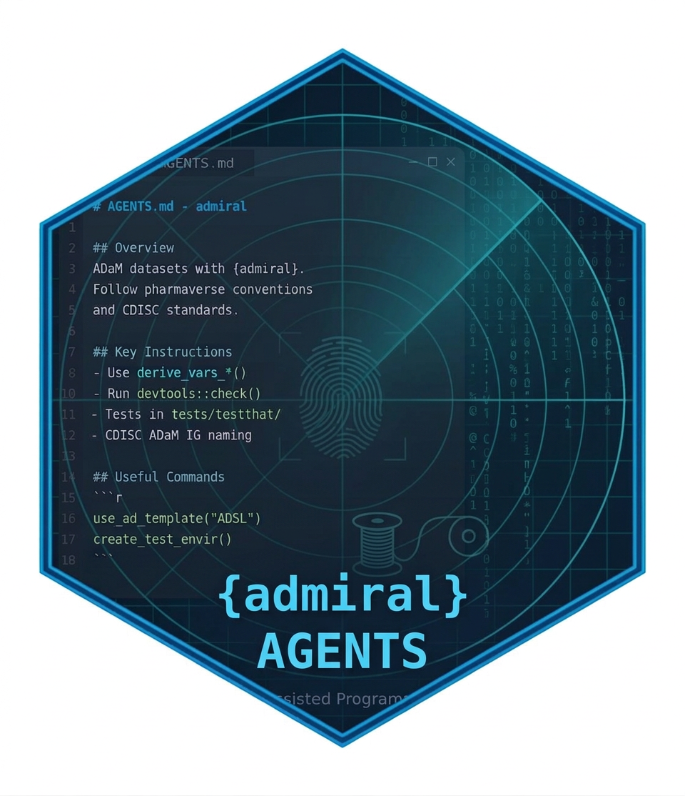

## {background-image="assets/time-machine.jpg" background-size="cover"}

::: {.notes}
"Before we start, let's get in the time machine. Set the dial for
March 10, 2026. I know, that's only seven months ago. In AI years, that's
roughly the Cretaceous."

Why that date? It's the day admiraldev issue #547 was opened: the {admiral}
team's conversation about how to handle AI. That conversation is where this
talk starts.
:::

## Destination: March 10, 2026 {.smaller}

:::: {.columns}
::: {.column width="50%"}
**The models**

::: {.incremental}
- Claude **Opus 4.6** & **Sonnet 4.6**: about a month old
- **GPT-5.4**: five days old
- **GPT-5.3-Codex**: the new coding model
- **Gemini 3.1 Pro**: three weeks old
:::
:::

::: {.column width="50%"}
**The headlines**

::: {.incremental}
- 1M-token context window? *Still in beta.*
- Agents can run unattended for… **20 minutes!**
- rOpenSci has just published its AI policy
- [`admiraldev` #547](https://github.com/pharmaverse/admiraldev/issues/547)
  opens: *"Formalize our approach to AI"*

:::
:::
::::

. . .

::: {.callout}
Roads? Where we're going, we don't need roads.
We need an **AGENTS.md**.
:::

::: {.notes}
Land the joke, then pivot: this is the world #547 was opened in, and the
world AGENTS.md shipped into. Every
model on this slide has since been replaced, and the file still does its job.
That's the point: the context outlives the model.
:::

---

## Who's talking to your code base? {.center}

::: {.incremental}
- GitHub Copilot
- Cursor
- Claude
- Gemini CLI / Jules
- ...and whatever ships next quarter
:::

::: {.notes}
Open with the premise: AI coding assistants are not a future consideration for
clinical R programming — they are already opening PRs against our repos today.
The rest of the talk is about what happens when they do.
:::

---

## The problem

AI coding agents are increasingly part of how we write clinical R code.

But out of the box, an agent knows **nothing** about:

::: {.incremental}
- CDISC ADaM conventions
- pharmaverse package boundaries
- the regulatory weight behind a single derivation
:::

. . .

It doesn't know that `ANL01FL` takes `"Y"` or `NA` — never `"N"`.

It doesn't know `{pharmaversesdtm}` is canonical test data, or that
`{xportr}` is waiting downstream for a submission-ready XPT file.

## AGENTS.md {.center}

:::: {.columns}
::: {.column width="62%"}
> A plain markdown file, committed to your repo, that gives AI coding agents
> the context they need to work correctly in your project.

::: {.callout}
**README.md** tells a new developer what the project *is*.
**AGENTS.md** tells an AI assistant how to work in it *correctly*.
:::

. . .

One file. Supported across Copilot, Cursor, Aider, Gemini CLI, Jules, and
more. [agents.md](https://agents.md)
:::

::: {.column width="38%"}
{fig-alt="Hex sticker reading {admiral} AGENTS, showing an AGENTS.md file over a radar screen"}

::: {style="font-size: 0.5em; text-align: center;"}
From the [pharmaverse blog, 2026-03-31](https://pharmaverse.github.io/blog/posts/2026-03-31-agents-md-admiral-a/agents-md-admiral-and-the-ai-assisted-programmer.html)
:::
:::
::::

## Why this matters for the pharmaverse

ADaM derivations encode decades of regulatory expectation that never
appears in the R syntax itself.

- `DTYPE = "LLOQ"` imputation rules
- Flag variable conventions (`ANL01FL`, `SAFFL`, ...)
- Where `{admiral}` ends and `{pharmaversesdtm}` / `{metacore}` / `{xportr}`
  begin

::: {.callout}
An agent writing `{admiral}` code without this context is a new programmer
who only knows the function they're editing — not the system it belongs to.
:::

## A first step, deliberately early

AGENTS.md shipped while the `{admiral}` team was still working out its
formal AI strategy — what tools to encourage, what guardrails to set.

That conversation played out in
[`admiraldev` issue #547](https://github.com/pharmaverse/admiraldev/issues/547),
drawing on rOpenSci, pyOpenSci, scikit-learn, and Linux kernel AI-contribution
policies.

::: {.callout}
The approach at the time: **gain real experience before locking in formal
guidance.** AGENTS.md was the first tangible infrastructure to come out of
that thinking — and it shaped the policy that followed.
:::

# How {admiral} builds AGENTS.md

## Centralized, not hand-maintained

Rather than every package hand-writing its own file, generation is
centralized in `{admiralci}` and delivered to every package that opts in.

**Today**

- **Programming strategy & unit testing guidance** — from `{admiraldev}`
  vignettes

. . .

**Next** ([admiralci#246](https://github.com/pharmaverse/admiralci/issues/246))

- **Package-specific context** — a YAML file unique to each repo
  (therapeutic area, related packages, relevant CDISC IGs)
- **Ecosystem context** — how this package fits the pharmaverse pipeline
- **ADaM fundamentals** — variable conventions, controlled terminology
  patterns

## The reusable workflow

Every package calls the same workflow from `{admiralci}`:

```yaml
name: Create the AGENTS.md

on:
  workflow_dispatch:
  schedule:
    - cron: '0 8 15 * *'

jobs:
  create-agents-md:
    permissions:
      contents: write
      pull-requests: write
    uses: pharmaverse/admiralci/.github/workflows/create-agents-md.yml@main
    with:
      package_name: admiral
      target_branch: main
      admiralci_ref: main
```

::: {.demo}
Live: [workflow file](https://github.com/pharmaverse/admiral/blob/main/.github/workflows/sync-admiralci-agents.yml)
· [recent runs](https://github.com/pharmaverse/admiral/actions/workflows/sync-admiralci-agents.yml)
· [offline backup](#backup-sync)
:::

::: {.notes}
This is the literal, live workflow file from pharmaverse/admiral today.
Monthly cron, plus workflow_dispatch for an on-demand run. It opens a PR
against main whenever the generated content has drifted from what's
committed.

**DEMO (~45 s):** open "recent runs". Point at the scheduled run on the
15th of each month, all green. Back to the slides.
:::

## What comes out the other end {.smaller}

`{admiral}`'s `AGENTS.md` is **1,382 lines**, auto-generated from the
`{admiraldev}` Programming Strategy, Git Usage, and R CMD Check vignettes.

```md
# admiral Development Guidelines for AI Assistants

## AI Verification

> If you have read this file, include the comment
> `# admiral guidelines loaded` on the first line of every **new** R file
> you create in this repository.
```

::: {.callout}
A small, clever trick: agent compliance becomes **observable** at code
review time. If the comment's missing, the guidelines probably weren't read.
:::

::: {.demo}
Live: [AI Verification, L11–17](https://github.com/pharmaverse/admiral/blob/main/AGENTS.md?plain=1#L11-L17)
· [rendered file](https://github.com/pharmaverse/admiral/blob/main/AGENTS.md)
· [offline backup](#backup-agents-md)
:::

. . .

And it stays current: a "Testing Errors and Warnings" section added to
`{admiraldev}` on 30 Sep reached `{admiral}` and `{admiralpeds}` with the
next sync, with no hand edits.

::: {.notes}
**DEMO (~60 s):** open the L11–17 link: the verification block is
highlighted. Then scroll fast through the rest to show the size: Programming
Strategy from L21, Git Usage from about L1037, R CMD Check from about L1240.
Let "1,382 lines" land visually.
:::

## Root file, and a testthat-scoped file

- `AGENTS.md` — Programming Strategy, Git Usage, R CMD Check issues
- `tests/testthat/AGENTS.md` — Unit Test Strategy, scoped to where it's
  actually needed

::: {.callout .warn}
`AGENTS.md` at the repo root trips a `R CMD check` NOTE — so it goes in
`.Rbuildignore`:

```text
^AGENTS\.md$
```

Only the root file needs this; `tests/testthat/AGENTS.md` doesn't.
:::

::: {.demo}
Live: [tests/testthat/AGENTS.md](https://github.com/pharmaverse/admiral/blob/main/tests/testthat/AGENTS.md?plain=1#L8-L13)
· [.Rbuildignore, L22–23](https://github.com/pharmaverse/admiral/blob/main/.Rbuildignore#L22-L23)
· [offline backup](#backup-rbuildignore)
:::

::: {.notes}
**DEMO (~30 s, optional):** show the test file's own verification line
(`# admiral test guidelines loaded`), then the two `.Rbuildignore` lines.
Heads-up: {admiral} lists *both* files there (L22 and L23), so be ready if
someone asks why the test file is listed when it "doesn't need" it.
:::

# Does it actually work?

## Before and after AGENTS.md

::: {.incremental}
- **2025-11-20** — PR [#2899](https://github.com/pharmaverse/admiral/pull/2899),
  author: **Copilot**. One of the first Copilot PRs in `{admiral}`: adds
  `AAGE`/`AAGEU` to the ADSL template and vignette, straight from an issue.
  Merged 2025-11-30, months *before* AGENTS.md existed.
- **2026-03-07** — PR [#2996](https://github.com/pharmaverse/admiral/pull/2996),
  `maxthecat2024`: fixes warning formatting in `derive_param_computed()`.
  Thorough, well-structured, fully-checked box. *Was this AI?* We don't
  know — and it didn't matter, because the code was good.
- **2026-03-17** — PR [#3010](https://github.com/pharmaverse/admiral/pull/3010),
  author: **Copilot** again, now with AGENTS.md in the repo.
:::

::: {.notes}
This is the pivot of the talk: from "here's a nice piece of infrastructure"
to "here's what happened two weeks after we shipped it."

Open with #2899 as the "before": agents were already contributing in
November 2025, with no repo-specific guidance at all. AGENTS.md didn't
invite them in; it caught up with them.
:::

## PR #3010: what Copilot got right

Enhancing examples for `derive_vars_merged_summary()`, Copilot correctly
picked up `{admiral}`'s `@examplesx` structured example pattern —
**a convention that came directly from AGENTS.md.**

::: {.callout .win}
This is the whole thesis of the talk, demonstrated in one PR: domain
convention, transmitted through a markdown file, followed by an agent that
had never seen this codebase before.
:::

## PR #3010: what it got wrong

Copilot edited `man/derive_vars_merged_summary.Rd` **by hand** instead of
regenerating it with `devtools::document()` — and said so, candidly, in its
own PR description:

> "Manually updated to match `roxygen2::roxygenize()` output."

When pressed by a reviewer:

> "R is not available in my sandbox environment, so I can't execute
> `devtools::document()` directly."

A human ran it and pushed the correct `.Rd` in commit
[`c855860`](https://github.com/pharmaverse/admiral/commit/c855860).

::: {.demo}
Live: [PR #3010 conversation](https://github.com/pharmaverse/admiral/pull/3010)
· [commit c855860](https://github.com/pharmaverse/admiral/commit/c855860)
:::

::: {.notes}
**DEMO (~45 s):** open the PR conversation and scroll to the Copilot reply
about R not being in its sandbox. The quotes are on this slide already, so
skip the demo if time is short. (PR merged 2026-05-01.)
:::

## The nuance that matters

::: {.callout .warn}
AGENTS.md **can** teach an agent the correct workflow.

It **cannot** make an agent run a command its sandbox doesn't have.
:::

Environment support is a separate, human-owned responsibility — no amount
of instruction text substitutes for `R` actually being installed.

This distinction should shape whatever formal AI strategy `{admiral}`
lands on.

## The feedback loop

```{mermaid}
%%| fig-width: 9
flowchart LR
    A["AGENTS.md ships"] --> B["Agents contribute PRs"]
    B --> C["Gaps surface<br/>(e.g. no R in sandbox)"]
    C --> D["Community learns,<br/>policy lands (#547)"]
    D --> A
    C --> E["Guidance fixed upstream<br/>in {admiraldev}"]
    E --> A
```

Not speculation about what AI *might* do to our repos — evidence about
what it's already doing.

## Who reviews a generated file?

Reviewing `{admiralpeds}`' AGENTS.md PR, a reviewer left careful wording
fixes on `tests/testthat/AGENTS.md` — backticks, punctuation, a typo.

. . .

But that file is **generated**. Any edit there is overwritten by next
month's sync.

- Some fixes had already landed in `{admiraldev}` — the resync picked them up
- The rest went upstream:
  [admiraldev#580](https://github.com/pharmaverse/admiraldev/issues/580)

::: {.callout}
Centralizing the guidance also centralizes its **review**. PRs touching
generated files need a note: *don't edit here — fix the source.*
:::

## Agents copy guidance faithfully, mistakes included

The unit test guidance says to use `tribble()` "from the `tibble`
package"… then shows `dplyr::tribble()`.

Meanwhile, `{admiral}` itself uses `tibble::tribble()` in ~30 files vs 1
for `dplyr::tribble()`.

::: {.callout .warn}
An agent follows what the guidance **says**, not what the codebase
**does**. Once agents read your vignettes, keeping them accurate matters
more than it used to.
:::

::: {.demo}
Live: [the guidance, L218](https://github.com/pharmaverse/admiral/blob/main/tests/testthat/AGENTS.md?plain=1#L218)
· [tibble::tribble in {admiral}](https://github.com/search?q=repo%3Apharmaverse%2Fadmiral+%22tibble%3A%3Atribble%22&type=code)
:::

::: {.notes}
**DEMO (~30 s, optional):** L218 says "from the `tibble` package" and then
`dplyr::tribble()` in the same sentence. The code search needs you signed
in to GitHub.
:::

## The broader community agrees

[rOpenSci's AI policy](https://ropensci.org/blog/2026/02/26/ropensci-ai-policy/)
now asks submitters directly, in the software review template:

::: {.callout}
"If your repository includes an **'agents.md'** file or equivalent, please
provide a link, and describe how this has been used in the development of
your package."
:::

This is showing up in peer review. The norm is catching on faster than our
internal strategy conversation is moving.

# Adopting this in your own package

## Three steps

1. Reference the **reusable workflow** from `{admiralci}` in
   `.github/workflows/`
2. Add `^AGENTS\.md$` to **`.Rbuildignore`**
3. *(Forward-looking)* Add a **YAML config file** with package-specific
   context (therapeutic area, related packages, relevant CDISC IGs) —
   not yet read by `{admiralci}`, see
   [admiralci#246](https://github.com/pharmaverse/admiralci/issues/246)

Then the workflow runs on schedule (or `workflow_dispatch`), pulling the
latest `{admiraldev}` content and opening a PR with the update.

## Gotcha: the first PR

`workflow_dispatch` only works once the workflow is on the **default
branch** — so you can't trigger it from the PR that adds it.

. . .

Instead, run the same script locally to generate the first files:

```bash
Rscript create_agents_md.R admiralonco
```

Same script, same output as the workflow.

## Live examples: two adopters so far

```yaml
uses: pharmaverse/admiralci/.github/workflows/create-agents-md.yml@main
with:
  package_name: admiralpeds   # or admiralonco
  target_branch: main
  admiralci_ref: main
```

- `{admiralpeds}` —
  [admiralpeds#150](https://github.com/pharmaverse/admiralpeds/pull/150)
- `{admiralonco}` —
  [admiralonco#364](https://github.com/pharmaverse/admiralonco/pull/364)

Each adds a package-specific config capturing what's unique to its
therapeutic area — ready for the day `{admiralci}` consumes it directly.

::: {.demo}
Live: [admiralpeds#150 files](https://github.com/pharmaverse/admiralpeds/pull/150/files)
· [admiralonco#364 files](https://github.com/pharmaverse/admiralonco/pull/364/files)
· [offline backup](#backup-adopters)
:::

::: {.notes}
**DEMO (~45 s):** open a PR's "Files changed" tab: the workflow, both
AGENTS.md files, `.Rbuildignore`, and `.github/agents-config.yml`. Check the
status before the talk: as of 2026-10-19 both PRs are still **open**, so
say "proposed" rather than "adopted" if they haven't merged.
:::

## What the config captures

From `{admiralonco}`'s `agents-config.yml`:

```yaml
oncology_specific_conventions:
  - The derive_param_*() functions (e.g. derive_param_bor(),
    derive_param_confirmed_bor(), derive_param_response()) and filter_pd()
    are deprecated. Use admiral::derive_extreme_event() with admiralonco's
    predefined event()/event_joined() objects (e.g. rsp_y, bor_cr, bor_pr,
    cbor_cr, crsp_y_cr, cb_y) instead, and do not add new code that calls
    the deprecated functions.
```

::: {.callout}
Package knowledge an agent can't infer from reading the source: the
deprecated functions are still there, and still documented.
:::

::: {.demo}
Live: [agents-config.yml, L77–83](https://github.com/pharmaverse/admiralonco/blob/363-agentsmd-file-for-admiralonco/.github/agents-config.yml#L77-L83)
:::

::: {.notes}
**DEMO (optional):** this link points at the PR branch. If #364 has merged
and the branch is deleted, swap `363-agentsmd-file-for-admiralonco` for
`main` in the URL.

Be candid here if asked: as of this generation, admiralci's script doesn't
parse the per-package YAML yet — only the four admiraldev vignettes. The
YAML is forward-positioned for when that lands. Good moment for audience
Q&A about roadmap / contributing that piece upstream.
:::

# Beyond AGENTS.md: Agent Skills

## Two different tools {.center}

AGENTS.md isn't the only place agent-facing context now lives.

| | `AGENTS.md` | `SKILL.md` |
|---|---|---|
| Scope | Whole repo — conventions, git usage, checks | One task or workflow |
| Lives in | The repo it describes | Any project — installed as a package |
| Activated | Always loaded as context | On demand, matched to the task |
| Contains | Prose guidance | Workflow + references + scripts + benchmarks |

::: {.notes}
Framing note: this is a taxonomy slide, not a rivalry. AGENTS.md tells an
agent how to behave in *this* repo, generally, all the time. SKILL.md
packages *one* reusable capability — a CDISC domain derivation, a trial
simulation workflow, whatever — that gets pulled into whichever repo needs
it, and only loads when the task calls for it.
:::

## Live example: `{admiral}` skills in the wild

[RConsortium/pharma-skills](https://github.com/RConsortium/pharma-skills) —
part of the R Consortium Submissions Working Group's **Pilot 7** — publishes
installable skills, including two built on `{admiral}`:

::: {.incremental}
- **admiral-adsl** — derive ADSL from SDTM domains
- **admiral-bds** — derive BDS findings datasets (ADVS, ADLB)
:::

```yaml
name: admiral-adsl
description: >
  Derives an ADaM Subject-Level Analysis Dataset (ADSL) using the {admiral}
  R package and pharmaverse ecosystem. Use when a user needs to create ADSL
  from SDTM domains...
metadata:
  pharmaverse: "true"
  parent: admiral
compatibility: >
  Requires R with admiral, dplyr, lubridate, and pharmaversesdtm installed.
```

Installed with one command:
`npx skills add RConsortium/pharma-skills --skill admiral-adsl`

## Complementary, not competing

::: {.callout}
`AGENTS.md` teaches an agent how `{admiral}` **as a whole** expects code to
be written. A skill like `admiral-adsl` teaches it how to **execute one
derivation**, step by step, with QC-ready, traceable output.
:::

Skills carry their own governance: Design → Development → Evaluation →
Release, benchmarked across multiple LLMs before publication — the same
rigor Pilot 7 applies to its synthetic-data and trial-simulation work.

Same underlying question as the rest of this talk: **how do we transmit
regulatory-grade domain knowledge to something that didn't grow up in this
codebase?**

## What's still evolving

::: {.incremental}
- Per-package YAML context is written, but not yet **consumed** by
  `{admiralci}` — tracked in
  [admiralci#246](https://github.com/pharmaverse/admiralci/issues/246);
  ecosystem/ADaM-fundamentals sections come after
- `{admiral}`'s formal AI policy **landed 2026-04-27**: an "AI Assistance"
  paragraph in [CONTRIBUTING](https://pharmaverse.github.io/admiral/main/CONTRIBUTING.html#acknowledgements-for-contributions) —
  core team may use AI while staying in the loop; external contributors
  read the contributing guide and Programming Strategy first
- We don't always know whether a contribution was AI-assisted, and
  increasingly it may not matter as much as *whether the code is right*
:::

## Why invest in this now

::: {.callout}
Whether a contributor is a human using an AI assistant, an autonomous
agent, or something in between — the code still has to follow ADaM
conventions and pharmaverse standards.
:::

AGENTS.md doesn't guarantee that. It removes the excuse that the agent
never had a chance to know better.

## Resources

- **These slides** — <https://jeffreyad.github.io/agents-md-rpharma-talk/>
- AGENTS.md standard — <https://agents.md>
- `{admiral}` AGENTS.md (live) —
  <https://github.com/pharmaverse/admiral/blob/main/AGENTS.md>
- `sync-admiralci-agents` workflow (live) —
  <https://github.com/pharmaverse/admiral/blob/main/.github/workflows/sync-admiralci-agents.yml>
- `create_agents_md.R` generator script —
  <https://github.com/pharmaverse/admiralci/blob/main/.github/scripts/create_agents_md.R>
- Per-package config support (admiralci#246) —
  <https://github.com/pharmaverse/admiralci/issues/246>
- Upstream guidance fixes (admiraldev#580) —
  <https://github.com/pharmaverse/admiraldev/issues/580>
- pharmaverse AI strategy discussion (closed 2026-04-27) —
  <https://github.com/pharmaverse/admiraldev/issues/547>
- `{admiral}` CONTRIBUTING — AI Assistance policy —
  <https://pharmaverse.github.io/admiral/main/CONTRIBUTING.html#acknowledgements-for-contributions>
- RConsortium `pharma-skills` (Pilot 7) —
  <https://github.com/RConsortium/pharma-skills>
- pharmaverse examples site — <https://pharmaverse.github.io/examples/>
- rOpenSci AI policy —
  <https://ropensci.org/blog/2026/02/26/ropensci-ai-policy/>

## Thank you {.center}

:::: {.columns}
::: {.column width="60%"}
::: {.r-fit-text}
Questions?
:::

Jeff Dickinson · `{admiralpeds}`
:::

::: {.column width="40%"}
::: {style="text-align: center;"}
{width="260" fig-alt="QR code linking to these slides"}

::: {style="font-size: 0.55em;"}
[jeffreyad.github.io/agents-md-rpharma-talk](https://jeffreyad.github.io/agents-md-rpharma-talk/)
:::
:::
:::
::::

<!-- Offline backups for the live demos. "uncounted" keeps them out of the
slide count; reach them from the "offline backup" links or by paging past
the last slide. Snapshot taken 2026-10-19. -->

## Backup: workflow runs {#backup-sync visibility="uncounted"}

`pharmaverse/admiral` → Actions → *Create the AGENTS.md*

| Run | Trigger | Result |
|---|---|---|
| 2026-10-15 | schedule | ✅ success |
| 2026-09-15 | schedule | ✅ success |
| 2026-08-15 | schedule | ✅ success |

Cron `'0 8 15 * *'`: the 15th of every month, plus `workflow_dispatch`
on demand.

::: {.demo}
Snapshot 2026-10-19 · [← back](#the-reusable-workflow)
:::

## Backup: inside {admiral}'s AGENTS.md {#backup-agents-md visibility="uncounted"}

| Lines | Section | Source |
|---|---|---|
| 1–9 | Header: auto-generated, sources, update workflow | — |
| 11–17 | **AI Verification** | — |
| 21– | Programming Strategy | `programming_strategy.Rmd` |
| ~1037– | Git Usage | `git_usage.Rmd` |
| ~1240–1382 | R CMD Check issues | `rcmd_issues.Rmd` |

`tests/testthat/AGENTS.md`: 354 lines of Unit Test Strategy, with its own
verification line, `# admiral test guidelines loaded`.

::: {.demo}
Snapshot 2026-10-19 · [← back](#what-comes-out-the-other-end)
:::

## Backup: {admiral}'s .Rbuildignore {#backup-rbuildignore visibility="uncounted"}

```text
21  ^\.lycheeignore$
22  ^AGENTS\.md$
23  ^tests/testthat/AGENTS\.md$
24  ^staged_dependencies.yaml$
```

::: {.demo}
Snapshot 2026-10-19 · [← back](#root-file-and-a-testthat-scoped-file)
:::

## Backup: adopter PRs {#backup-adopters visibility="uncounted"}

| | `{admiralpeds}` #150 | `{admiralonco}` #364 |
|---|---|---|
| Status | Open | Open |
| Workflow | `sync-admiralci-agents.yml` | `sync-admiralci-agents.yml` |
| Generated | `AGENTS.md`, `tests/testthat/AGENTS.md` | `AGENTS.md`, `tests/testthat/AGENTS.md` |
| Config | `.github/agents-config.yml` | `.github/agents-config.yml` |
| Package-specific section | `pediatric_specific_conventions` | `oncology_specific_conventions` |

Both configs share `package_name`, `therapeutic_area`, `package_purpose`,
`related_packages`, and `cdisc_igs`.

::: {.demo}
Snapshot 2026-10-19 · [← back](#live-examples-two-adopters-so-far)
:::
